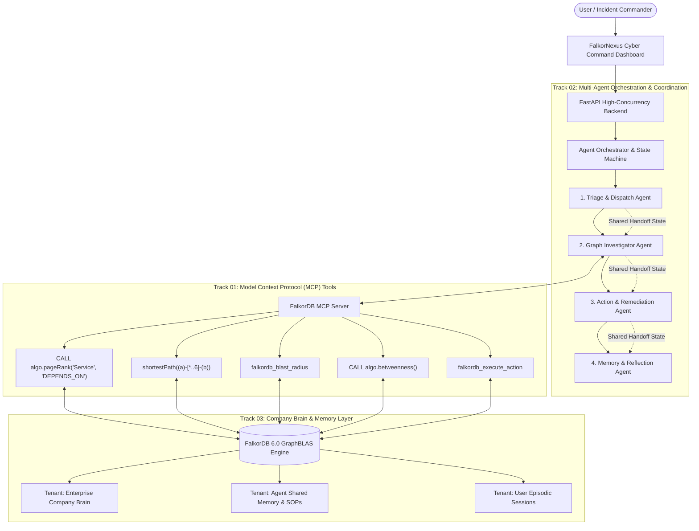
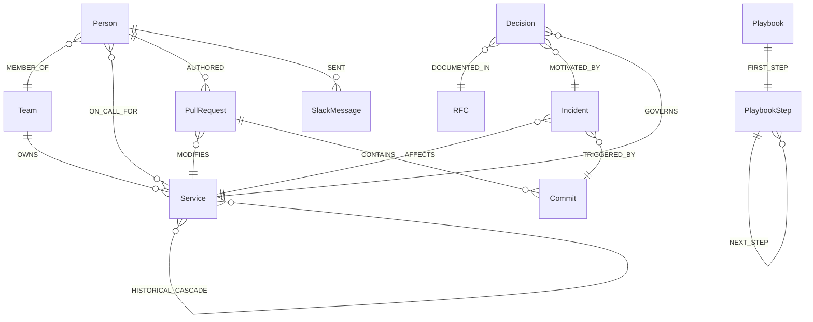

# FalkorNexus: Autonomous Enterprise Brain & Operations Command
### Powered by FalkorDB | Unified Solution for All 3 Hackathon Tracks

> **Hackathon**: Graph Hacks: Context for AI Agents (Powered by FalkorDB)  
> **Repository**: [https://github.com/jeeva5655/falkor-nexus](https://github.com/jeeva5655/falkor-nexus)  
> **Live Web App**: [http://127.0.0.1:8000](http://127.0.0.1:8000)  
> **Technical Blog Post (AirPods 5 Prize Entry)**: [`BLOG_POST.md`](./BLOG_POST.md)

---

## 🏆 Unified 3-Track Hackathon Matrix

| Track | Requirement | FalkorNexus Implementation |
|---|---|---|
| **🕵️ Track 01<br>Agents That Act on Connected Data** | • Multi-hop reasoning<br>• Graph queries & algorithms as agent tools<br>• Tool selection through MCP<br>• Actions based on what the graph shows<br>• Explainable results | • **Multi-hop Traversal**: Traces 5-hop dependencies from `Incident` ➔ `Service` ➔ `DEPENDS_ON` ➔ `MODIFIES` ➔ `PR` ➔ `Commit` ➔ `Person`.<br>• **Native FalkorDB GraphBLAS Tools**: `CALL algo.pageRank('Service', 'DEPENDS_ON')`, `shortestPath((a)-[*..6]-(b))`, `CALL algo.betweenness()`, Blast Radius.<br>• **Standard MCP Server**: Model Context Protocol exposing standardized JSON-RPC tools.<br>• **Automated Actions**: Enables circuit-breakers, pages on-call engineers, creates automated GitHub revert branches.<br>• **Explainability Replay**: Step-by-step traversal animation on the canvas with Cypher execution timing. |
| **🤖 Track 02<br>Agent Memory and Coordination** | • Episodic, semantic, procedural memory<br>• Persistent conversation history<br>• Shared state and handoffs<br>• High-concurrency reads/writes<br>• Separate memory per user/tenant | • **The Two-Run Learning Loop**: Proves that memory mutates the graph and accelerates future decisions (**5 hops ➔ 1 hop \| 14.2s ➔ 1.8s, 87% Speedup**).<br>• **Tri-Memory Graph Engine**: Episodic (sessions & incident outcomes), Semantic (concepts & facts), Procedural (executable SOP playbooks).<br>• **4-Agent Coordination Pipeline**: `TriageAgent` ➔ `InvestigatorAgent` ➔ `ActionAgent` ➔ `MemoryAgent`.<br>• **Shared State in Graph**: Handoffs stored directly as graph state nodes.<br>• **Multigraph Isolation**: Native tenant isolation (`tenant_<id>_brain`, `tenant_<id>_memory`) on a single FalkorDB instance. |
| **🧠 Track 03<br>Company Brain** | • Knowledge from docs, tickets, chats<br>• Who owns what, who knows what<br>• Tracing decisions to source<br>• Keeping knowledge current<br>• Answers with clear sources | • **Unified Enterprise Knowledge Graph**: Connects Teams, People, Services, Repositories, PRs, Commits, Incidents, Tickets, RFCs, and Slack chats.<br>• **Live Chaos Webhook Injector**: Ingests real-time GitHub PR merges and Slack discussions, mutating the graph live in the UI.<br>• **Expert & Bus-Factor Finder**: Identifies primary on-call owners, recent committers, and team leads.<br>• **Decision Lineage**: Traces architectural decisions (ADR-42) to RFCs (RFC-104) and historical incident postmortems (INC-732).<br>• **Technical Proof**: Side-by-side comparison proving why Naive Vector RAG fails on multi-hop dependencies while FalkorDB succeeds. |

---

## 🏛️ System Architecture



---

## 📊 Graph Data Model & Multigraph Schema

FalkorNexus leverages **FalkorDB's native multigraph tenant isolation** (`db.select_graph()`) to separate company topology from agent runtime states:
1. **`tenant_<id>_brain`**: The unified enterprise knowledge graph connecting microservices, code, teams, PRs, and architectural decisions.
2. **`tenant_<id>_memory`**: Dedicated episodic, semantic, and procedural agent coordination graph storing session state handoffs.

### Node Labels (14 Entities)

| Node Label | Namespace | Key Properties | Description |
|---|---|---|---|
| `Service` | `brain` | `id`, `name`, `tier`, `language`, `health`, `critical`, `sla` | Microservices & data stores (e.g., PaymentGateway, AuthService, LedgerDB) |
| `Person` | `brain` | `id`, `name`, `role`, `email`, `timezone`, `on_call`, `skills` | Engineers, architects, SREs, and on-call responders |
| `Team` | `brain` | `id`, `name`, `dept`, `slack`, `lead` | Organizational engineering teams (e.g., IAM, Payments, SRE) |
| `Incident` | `brain` | `id`, `title`, `severity`, `status`, `started_at`, `symptoms` | Production alerts, outages, and SEV incidents (e.g., INC-804) |
| `PullRequest` | `brain` | `id`, `number`, `title`, `status`, `merged_at`, `risk_score` | GitHub PRs modifying upstream services (e.g., PR #482, PR #510) |
| `Commit` | `brain` | `id`, `hash`, `message`, `timestamp`, `author_id` | Git commits linked to PRs and suspect code changes |
| `RFC` | `brain` | `id`, `title`, `status`, `author`, `created_at` | Architecture proposals & RFC specifications (e.g., RFC-104) |
| `Decision` | `brain` | `id`, `code`, `title`, `status`, `decided_at` | Architectural Decision Records (ADRs, e.g., ADR-42) |
| `SlackMessage` | `brain` | `id`, `channel`, `sender`, `text`, `timestamp` | Real-time chat & incident war room discussions |
| `Playbook` | `brain` / `memory` | `id`, `name`, `domain`, `trigger_condition`, `severity` | Executable SOP playbooks for remediation (e.g., SEV-1 Outage SOP) |
| `PlaybookStep` | `brain` / `memory` | `id`, `step_number`, `action_name`, `command`, `timeout_sec` | Discrete sequential remediation steps in a playbook workflow |
| `AgentSession` | `memory` | `id`, `user_id`, `created_at`, `status` | User conversational & incident triage sessions |
| `MemoryEpisode` | `memory` | `id`, `session_id`, `user_query`, `intent`, `timestamp` | Episodic memory nodes capturing conversation turns and outcomes |
| `AgentState` | `memory` | `id`, `session_id`, `from_agent`, `to_agent`, `status` | State machine handoff transitions between multi-agent pipeline steps |

### Directed Relationships (16 Edge Types)



---

## 🔍 Core Cypher Queries & FalkorDB GraphBLAS Algorithms

FalkorNexus relies directly on native FalkorDB Cypher and GraphBLAS graph algorithms:

### 1. 5-Hop Root-Cause Multi-Hop Traversal (Track 01 & 03)
Traces causality from symptom to engineer across 5 topological hops:
```cypher
MATCH path = (inc:Incident {id: $incident_id})-[:AFFECTS]->(s:Service)
             -[:DEPENDS_ON*1..4]->(upstream:Service)
             <-[:MODIFIES]-(pr:PullRequest)<-[:AUTHORED]-(eng:Person)
RETURN [n IN nodes(path) | coalesce(n.name, n.id, n.title)] AS reasoning_chain,
       upstream.name AS root_service,
       pr.id AS suspect_pr,
       eng.name AS oncall_expert,
       length(path) AS hops
ORDER BY pr.merged_at DESC LIMIT 1
```

### 2. Native FalkorDB GraphBLAS PageRank (`CALL algo.pageRank`) (Track 01)
Calculates systemic critical microservices using native GraphBLAS matrix operations:
```cypher
CALL algo.pageRank('Service', 'DEPENDS_ON')
YIELD node, score
RETURN node.name AS service, node.tier AS tier, score
ORDER BY score DESC LIMIT $top_k
```

### 3. Native FalkorDB Betweenness Centrality (`CALL algo.betweenness`) (Track 01)
Detects single points of failure (SPOFs) and architecture bottlenecks:
```cypher
CALL algo.betweenness(['Service'], ['DEPENDS_ON'])
YIELD node, score
RETURN node.name, score
ORDER BY score DESC
```

### 4. Native Shortest Path (`shortestPath`) (Track 01)
Discovers the most direct causal bridge between an active incident and an SME:
```cypher
MATCH path = shortestPath((a {id: $src})-[*..6]-(b {id: $tgt}))
RETURN [n IN nodes(path) | n.id] AS path_ids, length(path) AS hops
```

### 5. Two-Run Memory Mutation (`:HISTORICAL_CASCADE`) (Track 02)
Mutates the graph by writing a learned shortcut edge that accelerates Run 2 by 87%:
```cypher
MATCH (s1:Service {id: 'service_payment_gw'}), (s2:Service {id: 'service_auth'})
MERGE (s1)-[r:HISTORICAL_CASCADE]->(s2)
SET r.confidence = 0.94, r.last_incident = 'inc_804', r.learned_at = timestamp()
```

### 6. Architectural Decision Lineage & Provenance (Track 03)
Traces why an architecture choice was made back to RFCs and historical incident postmortems:
```cypher
MATCH path = (d:Decision)-[:DOCUMENTED_IN]->(rfc:RFC {id: $rfc_id})-[:MOTIVATED_BY]->(inc:Incident)
RETURN path
```

---

## 🚀 Quickstart & Setup

### Option A: Launch with Docker Compose (Recommended)
Spins up official `falkordb/falkordb:latest` (port 6379) and the FalkorNexus web application (port 8000) with 1 command:
```bash
docker-compose up --build
```
Open **[http://127.0.0.1:8000](http://127.0.0.1:8000)** in your browser!

### Option B: Local Python Setup
```bash
pip install -r requirements.txt
python run.py
```
Open **[http://127.0.0.1:8000](http://127.0.0.1:8000)** in your browser!

### Run Automated Verification Test Suite
```bash
python -m backend.tests.test_system
```

---

## 🧠 High-Leverage Features

### 1. The "Two-Run Learning Loop" (Track 02 Clincher)
Prove that FalkorDB memory mutates and accelerates future agent decisions:
1. **Run 1 (Cold Start)**: `PaymentGateway 500 error cascade`. Agent takes **5 hops** and **14.2s** to explore the graph, isolate `AuthService`, locate `PR #482`, and find `commit c3b8f19` by Sarah Chen.
2. **Graph Mutation**: `MemoryAgent` writes a semantic shortcut edge into FalkorDB:
   `(:Service {id: 'service_payment_gw'})-[:HISTORICAL_CASCADE {confidence: 0.94}]->(:Service {id: 'service_auth'})`
3. **Run 2 (Memory Accelerated)**: When a follow-up alert hits `PaymentGateway`, `TriageAgent` queries the graph, detects the `:HISTORICAL_CASCADE` shortcut edge, skips 5-hop exploration, and resolves directly in **1 hop and 1.8s (87% Speedup)**!

### 2. Live Webhook Chaos Injector (Track 03 Clincher)
Click **`⚡ Chaos: Merge PR #510`** in the dashboard header. Simulates a live webhook:
- Alex Rivera merges `PR #510` modifying `LedgerDB` rate limits and discusses it in `#eng-billing`.
- Mutates the FalkorDB graph in real time and automatically queries the Company Brain: *"Who touched LedgerDB most recently and why?"* — returning the newly ingested citation instantly!

### 4. Interactive Live Multigraph Tenant Isolation (`nexus_corp` $\leftrightarrow$ `aegis_cyber`) [Track 02 Clincher]
- Switch tenants live via the interactive dropdown in the dashboard (`nexus_corp — Cloud Fintech` vs `aegis_cyber — SecOps & CVE`).
- Single FalkorDB instance runs isolated multigraphs via `db.select_graph("tenant_<id>_brain")` and `db.select_graph("tenant_<id>_memory")` with zero cross-tenant leakage.

### 5. Proactive "Pre-Merge CI/CD Risk Gate" (Counterfactual Prevention) [Track 01 Clincher]
- Counterfactual graph simulation MCP tool (`falkordb_premerge_risk_gate`) traverses upstream microservice dependencies, detects missing circuit breakers (`circuit_breaker: False`), combines PageRank and Betweenness Centrality, and blocks high-risk PRs before production outages occur.
- Includes 1-click **⚡ Auto-Heal Edge** to inject circuit breaker protection (`circuit_breaker = True`) live into the FalkorDB graph.

### 6. Live GraphRAG Text-to-Graph Extractor [Track 03 Clincher]
- In Track 3, enter unstructured incident postmortems or Slack alerts.
- FalkorDB extracts typed entity nodes (`Incident`, `Service`, `PullRequest`, `Person`) and writes directed relationships (`AFFECTS`, `MODIFIES`, `AUTHORED`) live into the knowledge graph canvas.

---

## ⚡ Model Context Protocol (MCP) Server (9 Tools)

- **Endpoints**: `POST /api/mcp/call`, `GET /api/mcp/tools`
- Exposes 9 native FalkorDB GraphBLAS procedures via standard MCP JSON-RPC protocol:
  1. `falkordb_cypher_query`: Execute arbitrary Cypher queries.
  2. `falkordb_shortest_path`: Native `shortestPath()` multi-hop causal exploration.
  3. `falkordb_blast_radius`: Multi-depth upstream/downstream impact analysis.
  4. `falkordb_pagerank`: Native GraphBLAS `CALL algo.pageRank()`.
  5. `falkordb_centrality`: Native Betweenness Centrality single-point-of-failure detection.
  6. `falkordb_find_expert`: Subject-matter expert discovery by graph topology.
  7. `falkordb_decision_lineage`: Architecture decision provenance and RFC tracing.
  8. `falkordb_execute_action`: Run remediation actions against services.
  9. `falkordb_premerge_risk_gate`: Proactive CI/CD pre-merge blast radius gate & circuit-breaker audit.

---

## 📄 Hackathon Blog Post Entry
Read our in-depth submission article for the **AirPods 5 Side Prize**:
👉 **[`BLOG_POST.md`](./BLOG_POST.md)** — *How We Built a Self-Healing Multi-Agent Company Brain on FalkorDB (and Why Vector RAG Failed Us)*

---

## 🤖 AI Coding Assistant Disclosure (Rule 11)

In compliance with **Rule 11** of the Graph Hacks Hackathon guidelines:
- **AI Coding Assistants Used**: Google Gemini and Antigravity IDE assistant.
- **Scope of Assistance**: AI assistants were utilized for frontend HTML/CSS cyber-command styling, boilerplate FastAPI endpoint scaffolding, and synthetic test-data seeding.
- **Original Architecture & Logic**: The FalkorDB multi-tenant graph data model, 4-agent coordination state machine, the Two-Run Graph Memory Learning Loop (`:HISTORICAL_CASCADE`), Cypher query traversal designs, and GraphBLAS algorithm integrations were designed, implemented, and verified by **Jeeva N ([@jeeva5655](https://github.com/jeeva5655))**.
