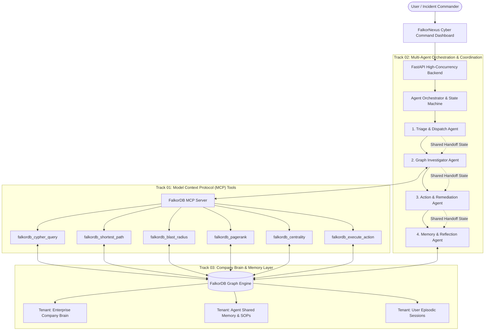

# FalkorNexus: Autonomous Enterprise Brain & Operations Command
### Powered by FalkorDB | Unified Solution for All 3 Hackathon Tracks

> **Hackathon**: Graph Hacks: Context for AI Agents (Powered by FalkorDB)  
> **Repository**: `c:\Users\ninje\Desktop\graph agents`  
> **Live Web App**: [http://127.0.0.1:8000](http://127.0.0.1:8000)

---

## 🏆 Unified 3-Track Hackathon Matrix

| Track | Requirement | FalkorNexus Implementation |
|---|---|---|
| **🕵️ Track 01<br>Agents That Act on Connected Data** | • Multi-hop reasoning<br>• Graph queries & algorithms as agent tools<br>• Tool selection through MCP<br>• Actions based on what the graph shows<br>• Explainable results | • **Multi-hop Traversal**: Traces 5-hop dependencies from `Incident` ➔ `Service` ➔ `DEPENDS_ON` ➔ `MODIFIES` ➔ `PR` ➔ `Commit` ➔ `Person`.<br>• **Native Graph Algorithm Tools**: Shortest Path, PageRank, Centrality (Betweenness & Degree), Community Detection, Blast Radius.<br>• **Standard MCP Server**: Model Context Protocol exposing standardized JSON-RPC tools.<br>• **Automated Actions**: Enables circuit-breakers, pages on-call engineers, creates automated GitHub revert branches.<br>• **Explainability**: Outputs visual subgraphs, Cypher statements, and transparent reasoning logs. |
| **🤖 Track 02<br>Agent Memory and Coordination** | • Episodic, semantic, procedural memory<br>• Persistent conversation history<br>• Shared state and handoffs<br>• High-concurrency reads/writes<br>• Separate memory per user/tenant | • **Tri-Memory Graph Engine**: Episodic (sessions & incident outcomes), Semantic (concepts & facts), Procedural (executable SOP playbooks).<br>• **Multi-Session Store**: Preserves conversation history across user sessions.<br>• **4-Agent Coordination Pipeline**: `TriageAgent` ➔ `InvestigatorAgent` ➔ `ActionAgent` ➔ `MemoryAgent`.<br>• **State Handoffs in Graph**: Shared state persisted directly as graph nodes & transitions.<br>• **Multigraph Isolation**: Native tenant isolation (`tenant_<id>_brain`, `tenant_<id>_memory`). |
| **🧠 Track 03<br>Company Brain** | • Knowledge from docs, tickets, chats<br>• Who owns what, who knows what<br>• Tracing decisions to source<br>• Keeping knowledge current<br>• Answers with clear sources | • **Unified Enterprise Knowledge Graph**: Connects Teams, People, Services, Repositories, PRs, Commits, Incidents, Tickets, RFCs, and Slack chats.<br>• **Expert & Bus-Factor Finder**: Identifies primary on-call owners, recent committers, and team leads.<br>• **Decision Lineage**: Traces architectural decisions (ADR-42) to RFCs (RFC-104) and historical incident postmortems (INC-732).<br>• **Real-time Event Ingestion**: Live webhook endpoint for commits, tickets, and Slack messages.<br>• **Verifiable Citations**: Every answer links directly to verified graph nodes. |

---

## 🏛️ System Architecture



---

## 🚀 Quickstart & Setup

### 1. Prerequisites
- Python 3.10+ (Tested on Python 3.11)
- Node.js 18+ (Optional)
- Docker (Optional: FalkorDB Dual-Mode works 100% out-of-the-box offline with zero dependencies, and connects to live FalkorDB Docker or Cloud with 1 click).

### 2. Installation
```bash
cd "c:\Users\ninje\Desktop\graph agents"
pip install -r requirements.txt
```

### 3. Launch the Application
```bash
python run.py
```
Open **[http://127.0.0.1:8000](http://127.0.0.1:8000)** in your browser!

### 4. Run Automated Test Suite (Verifies all 3 tracks)
```bash
python -m backend.tests.test_system
```

---

## 🔌 FalkorDB Dual-Mode Architecture

FalkorNexus includes a resilient **Dual-Mode Graph Engine**:
1. **Live FalkorDB**: Connects seamlessly to any local Docker instance (`docker run -p 6379:6379 -it --rm falkordb/falkordb`) or **FalkorDB Cloud** instance via `FALKORDB_URL=falkor://...`.
2. **High-Speed Built-In Fallback**: When live FalkorDB is not connected, operates on a high-speed FalkorDB-compatible in-memory property graph engine powered by NetworkX algorithms.
3. **1-Click Sync**: Click the FalkorDB badge in the UI header at any time, enter your FalkorDB Cloud URI, and click **Connect & Sync Data** to populate your live database in milliseconds!

---

## ⚡ Model Context Protocol (MCP) Server

FalkorNexus implements the standard **Model Context Protocol (MCP)** specification:
- **Endpoint**: `POST /api/mcp/call`, `GET /api/mcp/tools`
- **Supported Tools**:
  - `falkordb_cypher_query`: Run Cypher statements on any graph namespace.
  - `falkordb_shortest_path`: Compute shortest semantic path between entities.
  - `falkordb_blast_radius`: Multi-depth cascading dependency impact analysis.
  - `falkordb_pagerank`: Identifies systemic critical hubs.
  - `falkordb_centrality`: Computes betweenness (bottlenecks) and degree centrality.
  - `falkordb_community_detection`: Uncovers microservice and team clusters.
  - `falkordb_find_expert`: Resolves on-call schedules, code authorship, and team owners.
  - `falkordb_decision_lineage`: Traces architectural decisions to RFCs and postmortems.
  - `falkordb_execute_action`: Triggers automated circuit-breaker quarantine, PagerDuty pages, and GitHub revert PRs.

---

## 🎮 Interactive Demo Scenarios

### Scenario 1: Critical Outage Blast-Radius & Triage (Tracks 1 & 3)
- **Symptom**: `PaymentGateway` throwing 500 error cascades.
- **Agent Workflow**:
  1. `TriageAgent` classifies `OUTAGE_TRIAGE`.
  2. `InvestigatorAgent` runs `falkordb_blast_radius` on `service_payment_gw`, discovering dependency on `AuthService`.
  3. Queries recent PRs in radius: discovers `PR #482` authored by `Sarah Chen` containing commit `c3b8f19` merged 1.5h ago.
  4. Computes `falkordb_shortest_path` connecting `inc_804` to `sarah_chen`.
  5. `ActionAgent` activates circuit-breaker on `AuthService`, pages on-call architect `Sarah Chen`, and drafts revert PR.
  6. `MemoryAgent` persists session episode into FalkorDB and creates semantic link `(PaymentGateway)-[:PREVIOUSLY_CASCADED_FROM]->(AuthService)`.

### Scenario 2: Multi-Agent Memory & SOP Handoff (Track 2)
- Recalls past episodic sessions and loads the 4-step `plb_sev1_triage` procedural workflow chain directly from the graph.
- Shows real-time agent handoff state machine.

### Scenario 3: Decision Provenance & Knowledge Lineage (Track 3)
- Query: *"Why did we migrate to FalkorDB in RFC-104?"*
- Traverses: `Decision: ADR-42` ➔ `RFC-104` ➔ `Author: Sarah Chen` ➔ `Motivated By: INC-732 (Auth Token Revocation Memory Leak postmortem)`.

---

## 📊 Summary of Tech Stack
- **Graph Database**: FalkorDB (Official Python SDK `falkordb>=1.8.0`) + Dual-Engine Fallback
- **Backend**: Python 3.11, FastAPI, Pydantic v2, NetworkX, Uvicorn
- **Protocol**: Model Context Protocol (MCP)
- **Frontend**: Vanilla HTML5, Modern Canvas Force-Directed Physics Graph Visualizer, Glassmorphism, CSS Custom Properties
